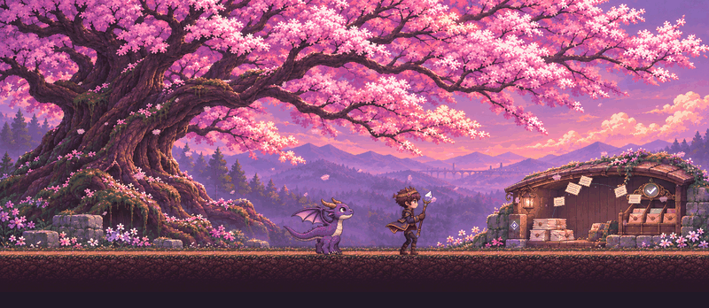
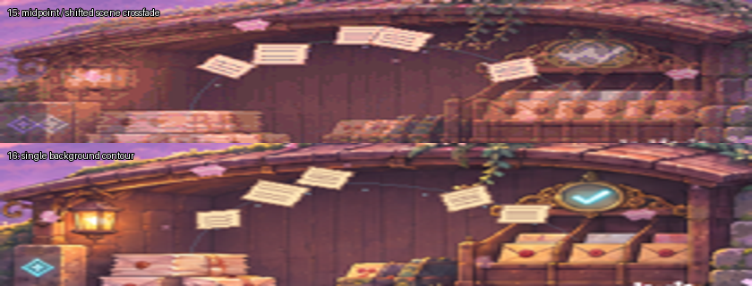

# V5 — single-contour test candidate

**테스트 후보이며, 실제 화면 재생의 자연스러움을 검증 완료한 최종본은 아닙니다.** 기존 15번 시안의 이중 윤곽과 캐릭터 접합 문제를 수정한 별도 버전입니다. 원본과 이전 시안은 유지합니다.



[MP4](exports/banner-v5-single-contour.mp4) · [로컬 재생 페이지](preview.html) · [검증 수치](exports/validation.json)

## 확인한 원인과 수정

| 항목 | 확인한 증거 | 변경 |
|---|---|---|
| 배경 이중 윤곽 | 이전 GIF 6초 지점에서 지붕·표지판 윤곽이 겹쳐 보임. 서로 12픽셀 떨어진 배경을 혼합하는 코드도 확인 | 원경 크로스페이드 제거. 배경을 한 번만 합성하고 지면만 실제 반복 스크롤 |
| 배경에 캐릭터 잔상 | 캐릭터를 제거한 배경의 해당 영역을 직접 확인. 남은 캐릭터는 보이지 않음 | 이 부분을 원인으로 단정하지 않음 |
| 캐릭터 중복 합성 | 에반 몸통과 같은 위치의 몸통 상단을 두 번 그리는 코드 확인 | 몸통 한 번만 합성. 다리→몸통→팔 순서 정리 |
| 접합·변형 | 확대 검수에서 다리 하단 전체를 휘는 변형과 접합부 문제 확인 | 에반은 무릎 관절 회전, 미르는 원래 팔다리 실루엣을 유지하는 회전으로 수정. 발바닥은 별도로 수평 유지 |
| 작은 움직임의 계단 현상 | 이전 코드는 기본 해상도에서 위치를 정수로 반올림 | 3배 해상도 합성과 소수점 위치 변환 후 한 번 축소 |
| GIF 잔상·팔레트 | 출력 GIF를 다시 읽어 각 프레임을 팔레트 변환 직후 프레임과 비교 | 모든 프레임의 실제 디코딩 결과를 확인. 인코딩 성공만으로 시각 품질을 판정하지 않음 |



이 비교의 위쪽은 이전 GIF 중간 시점이고 아래쪽은 단일 배경입니다. 움직이는 종이는 서로 다른 시점이므로 비교 대상이 아닙니다. 지붕·벽·표지판의 고정 윤곽을 비교합니다.

## 움직임과 검수

- 12초, 25fps, 300프레임. GIF는 모두 40ms이며 무한 반복합니다.
- 화면 내 캐릭터 기준 위치를 고정합니다. 보행 주기는 1.5초이고 접지 목표점과 지면은 초당 20픽셀로 함께 뒤로 이동합니다.
- 원경과 건물은 고정하고, 가지·꽃 부분만 국소적으로 흔듭니다. 근경 지면은 240픽셀 타일을 12초에 한 번 순환합니다.
- `review/all-frames-00.jpg`부터 `11.jpg`까지 **300개 캐릭터 확대 프레임 전부**를 확인했습니다. 이 정지 프레임들에서는 몸통 분리나 캐릭터의 다중 윤곽을 관찰하지 못했습니다.
- 전체 풍경 48개 시점을 세 장의 시트로 확인했습니다. MP4 디코딩 샘플도 캐릭터와 건물 영역으로 대조했습니다.
- 파일·주기·색상 오차·연속 디코딩 검증 결과는 `exports/validation.json`에 있습니다. 이 수치는 자연스러운 보행의 지각적 검증을 대체하지 않습니다.

## 실제 재생 검수 제한

로컬 브라우저 새 탭 생성은 연결 도구의 `timeoutMs` 오류로 실패했습니다. Windows Media Player 레거시를 통한 로컬 재생도 초기 설정 창의 앱 접근 승인이 시간 초과되어 진행하지 못했습니다. 이전에 거절된 다른 브라우저 탭으로 우회하지 않았습니다. FFmpeg 실시간 디코딩은 화면을 보며 재생을 확인한 것으로 기록하지 않습니다.

따라서 버벅임·자연스러움이 모든 플레이어에서 해결되었다고 보증하지 않습니다. 2D 리그 특유의 제한된 관절 움직임은 남아 있습니다. 원경 전체가 흘러가는 긴 파노라마는 아니며, 고정 원경과 움직이는 지면으로 시차를 만듭니다. GIF는 제한된 팔레트이며, 로컬 WebP는 800×348 무손실 압축입니다.

## 재생성 및 보존

Python 3, Pillow, imageio-ffmpeg가 필요합니다.

```sh
python render.py --sample
python render.py
python finalize.py
```

`render.py`는 렌더와 원시 출력을 만들고, `finalize.py`는 배포 파일을 압축하면서 소스·GIF·WebP·MP4를 검증합니다. 무손실 WebP 원본은 `review/master-lossless.webp`, 축소본은 `exports/banner-v5-single-contour.webp`에 로컬로 보존합니다. 두 파일은 각각 약 63MB와 54MB이므로 Git에는 넣지 않고, 브랜치에는 약 10MB GIF와 약 3MB MP4를 제공합니다. 자산과 환경 코드는 이 폴더 안에 포함하여 이전 미추적 시안 폴더에 의존하지 않습니다.

이 브랜치는 배너 실험 파일만 추가합니다. 메인/통합 브랜치 병합이나 배포는 하지 않습니다.
