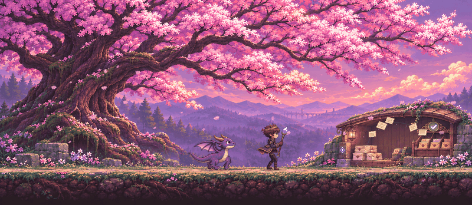
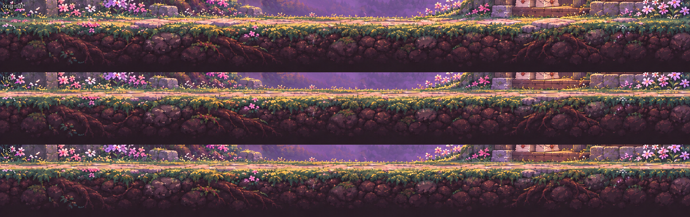

# V5 — 보행과 지면 재검수

16번의 이중 윤곽 수정만으로 충분하지 않았습니다. 미르의 늘어나는 다리, 에반의 굳은 상체, 평평해진 지면을 다시 점검하고 수정한 테스트 후보입니다. 승인 원본과 기존 시안은 그대로 보존합니다.



[MP4](exports/banner-v5-weighted-walk.mp4) · [재생·비교 페이지](preview.html) · [검증 결과](exports/validation.json) · [독립 시각 검수](review/visual-audit.md)

| 재검수에서 발견한 문제 | 변경 |
|---|---|
| 미르 다리 전체를 늘려 발 위치에 맞춰서 고무처럼 보임 | 길이가 고정된 두 관절로 발 위치를 풂. 앞·뒤 부착점을 30px로 벌리고 네 발이 차례로 움직이는 보행 적용 |
| 무릎과 발 부근의 잘린 그림이 두껍게 겹침 | 접합 끝의 둥근 마스크, 종아리 폭 조정, 수평 발바닥 유지 |
| 에반 상체와 코트가 통째로 굳어 있음 | 골반의 작은 좌우 이동, 가슴의 반응, 한 박자 늦게 움직이는 코트 끝을 연속 변형으로 연결 |
| 미르 꼬리·날개가 몸통과 완전히 고정됨 | 몸통 한 장을 연속 변형하여 꼬리·날개·머리에 작은 위상 차이 부여 |
| 바닥 전체가 작은 반복 타일과 단색 띠로 대체됨 | 원본 돌·꽃·뿌리·절벽 복원. 이동 영역을 기존 길의 좁은 접지면으로 제한 |
| 일부 검수표가 캐릭터를 세로로 늘려 표시함 | 모든 검수표를 원본 비율로 제작. 캐릭터는 300×150 크롭을 그대로 배치 |
| 지팡이 빛의 회전 부호가 팔의 회전과 다름 | 같은 좌표 변환을 사용해 최대 약 2px의 광원 어긋남 수정 |
| 풀의 바람 변형이 건물 하단으로 번짐 | 건물과 기초석을 덮는 변형 격자점을 고정. 불투명 이미지 차이를 RGB로 검사해 RGBA 알파 경계 판정이 놓친 변화도 검출 |

12초, 25fps, 300프레임입니다. GIF는 800×348, MP4는 1200×522이며 GIF는 무한 반복합니다. 캐릭터 기준 위치를 고정하고 접지한 발과 길은 초당 20px로 뒤로 이동합니다. 에반은 한 주기의 62%, 미르는 74% 동안 각 발을 접지합니다.



## 검수 범위와 한계

캐릭터 300프레임 전체를 12장, 전체 장면 48개 시점을 3장으로 나누어 확인했습니다. 확대 프레임과 원래 배너 크기를 함께 비교했습니다. GIF의 300개 디코딩 결과를 팔레트 변환 직후의 소스와 픽셀 단위로 대조하고, MP4는 3회 반복·900프레임 디코딩을 확인합니다. 이 검사는 실제 재생의 자연스러움을 보증하는 검사가 아닙니다.

이번에도 실제 화면에서 연속 재생하는 검수는 완료하지 못했습니다. 인앱 브라우저의 새 탭은 열렸으나 로컬 재생 서버 연결은 시간 초과됐고, 테스트 브랜치 MP4 직접 접근도 브라우저에서 차단됐습니다. 다른 사용자 탭이나 차단을 우회하는 경로는 사용하지 않았습니다.

미르의 관절은 여전히 그린 조각을 이어 쓰는 2D 리그이며, 에반의 상체 변화는 절제되어 있습니다. 먼 풍경과 큰 지형은 고정되고 좁은 길만 이동하므로 완전한 이동 파노라마는 아닙니다. GIF의 색상 수 제한도 남습니다.

## 재생성

```sh
pip install -r requirements.txt
python render.py --sample
python export.py
```

`render.py`는 프레임과 샘플을 만들고, `terrain.py`는 길의 합성, `environment.py`는 기존 풍경의 바람과 효과를 담당합니다. `export.py`는 현재 렌더러의 프레임을 한 번 생성한 뒤 모든 파일 검증을 수행합니다. 이전 실행의 무손실 원본을 재사용하지 않으며 `review/master-lossless.webp`를 매번 새로 생성합니다. 큰 무손실 파일은 Git에서 제외합니다.

자산은 16번에서 사용한 승인 원본·클린 플레이트·리그 아틀라스를 복사했습니다. 이번 수정에는 신규 AI 이미지 생성이 없습니다. 테스트 브랜치에만 저장하며 메인 병합이나 배포는 포함하지 않습니다.
