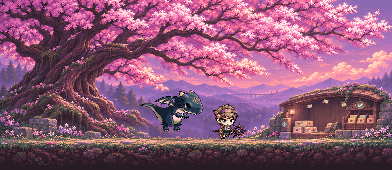

# 에반과 미르 — 원작 동작으로 다시 만든 배너

이전 17번의 지면 이동, 잘라 붙인 관절, 약한 나무 바람을 교체한 검토용 후보입니다. 사용자가 실제 메이플 도트로 바꾸는 방향을 선택했습니다.



[MP4 보기](exports/banner-v5-original-sprites.mp4) · [재생 페이지](preview.html) · [독립 시각 검수](review/visual-audit.md) · [파일 검증](exports/validation.json)

- **땅:** 승인 배경의 돌길·풀·절벽을 고정했습니다. 캐릭터가 실제로 길을 가로지릅니다.
- **에반:** 게임 원본 걷기 4장, 각 180ms입니다. 원본 등록점과 픽셀을 유지하고 오른쪽을 보도록 반전했습니다. 보폭에 맞춰 초당 55px 이동합니다.
- **미르:** 원작 성장 단계 2211의 비행 6장, 각 120ms입니다. 에반 뒤 110px에서 낮게 날아 따라옵니다. 날개·꼬리·다리를 새로 변형하지 않습니다.
- **나무:** 가지의 뿌리에서 끝으로 갈수록 바람의 움직임이 커집니다. 굵은 줄기·뿌리·건물·노출된 오른쪽 구름은 고정했습니다.
- **반복:** 두 캐릭터와 그림자가 완전히 화면 밖으로 나간 뒤 왼쪽에서 다시 들어옵니다. 화면 안에서 위치를 초기화하지 않습니다.

800×348, 20.16초, 672프레임입니다. 출력 간격은 30ms이며 원본 180/120ms 포즈 시간이 정확히 유지됩니다. 캐릭터는 매 출력마다 1~2px 이동합니다. 느린 나뭇가지 바람은 60ms마다 갱신됩니다.

## 외부 무료 방식의 실제 시험

무료 공개 Wan2.2 데모에서 이미지→영상 1회를 실행했습니다. 약 39초 만에 6초 영상을 받았지만, 에반의 얼굴·머리·체형과 미르의 외형이 바뀌어서 사용하지 않았습니다. [실패한 생성의 비교 프레임](review/rejected-ai-character-sheet.png)과 [판정 기록](review/rejected-ai-quality.json)을 남겼습니다. 결제·구독·유료 크레딧 사용은 없었습니다.

최종 후보는 [MapleStory.IO](https://maplestory.io/)의 로그인·결제 없는 공개 API에서 가져온 원본 스프라이트를 사용했습니다. 게임 자산의 저작권은 Nexon에 있으며 CC0 자산은 아닙니다. [선택한 동작과 등록점](sprite_trial/selected-motion.json), [출처](sprite_trial/provenance.json), [성장 단계 비교](sprite_trial/mir-stage-comparison.png)를 함께 보존합니다.

## 검수와 남은 한계

원본 발바닥과 등록점을 확대 대조했습니다. 에반 포즈 3에서 발보다 6px 아래로 내려가는 것은 부츠가 아닌 지팡이 가시입니다. 그 포즈에서 지팡이가 잔디를 살짝 스치는 원작 형태는 유지했습니다. [발 기준점 증거](sprite_trial/evan-feet-proof.png).

독립 검수에서 지면·접지·형태·퇴장을 확인하고, 추가로 발견한 수평 이동 간격과 구름 변형을 수정했습니다. GIF 672프레임 전체를 양자화 직후 원본과 대조했고 MP4는 3회 반복 디코딩했습니다. 이 검증은 화면 재생의 자연스러움을 보증하지 않습니다. 브라우저 재생 관찰 여부는 `validation.json`에 별도로 기록합니다.

원작 게임의 에반 걷기는 4장의 포즈를 유지하는 도트 애니메이션입니다. 33⅓fps는 화면 이동의 출력 빈도이며 33장의 새 보행 포즈를 만든다는 뜻은 아닙니다. GIF는 색상 제한과 파일 크기가 있어, 색감과 용량을 함께 보려면 MP4가 더 적합합니다.

## 재생성

```sh
pip install Pillow imageio-ffmpeg
python render.py
python export.py
```

배경은 기존 `17_v5_weighted_walk/assets/clean-plate.png`를 읽습니다. `sprite_trial`에 다운로드한 원본 PNG·메타데이터·조립 스크립트가 있습니다. `render.py`는 동작과 배경 합성, `export.py`는 내보내기와 검증을 담당합니다. 테스트 브랜치의 후보이며 메인 반영 상태는 아닙니다.
